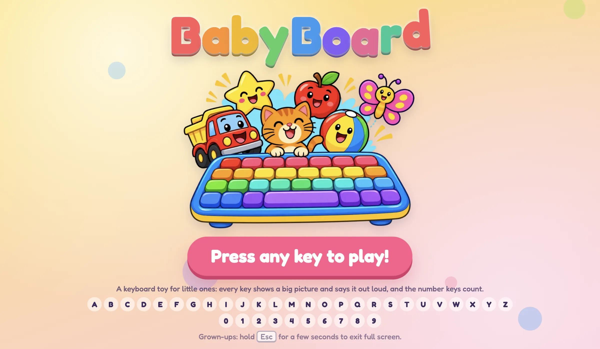
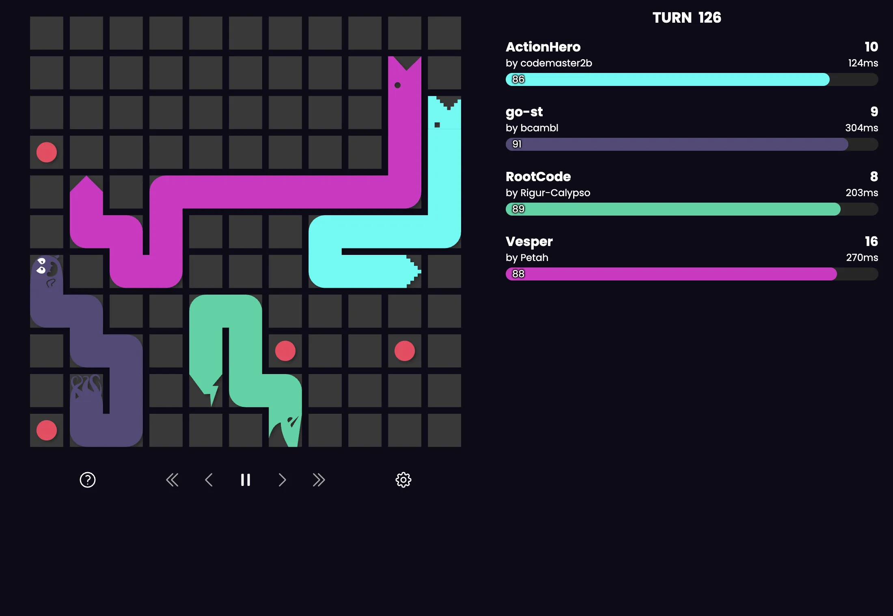

### Projects

<table>
<tr>
<td width="50%" valign="top">
<a href="https://toys.projectz.co.nz"></a>
<br>
<b><a href="https://github.com/Petah/kenny-toys">Kenney Toys</a></b><br>
Small browser games, each built around one Kenney asset pack. <a href="https://toys.projectz.co.nz">Play them</a>
</td>
<td width="50%" valign="top">
<a href="https://babyboard.projectz.co.nz"></a>
<br>
<b><a href="https://github.com/Petah/babyboard">BabyBoard</a></b><br>
A full-screen keyboard toy for babies and toddlers. <a href="https://babyboard.projectz.co.nz">Try it</a>
</td>
</tr>
<tr>
<td width="50%" valign="top">
<a href="https://github.com/Petah/battle-snake-project-z"></a>
<br>
<b><a href="https://github.com/Petah/battle-snake-project-z">Project Z</a></b><br>
A workspace for building and testing Battlesnake strategies. My snake Vesper is the pink one.
</td>
<td width="50%" valign="top">

```text
$ npx @petah/gamemaker-mcp gm-docs lookup draw_sprite
```

<b><a href="https://github.com/Petah/gamemaker-mcp">gamemaker-mcp</a></b><br>
An MCP server and CLI for searching the GameMaker docs, so AI assistants can look up GML functions. On npm as <a href="https://www.npmjs.com/package/@petah/gamemaker-mcp">@petah/gamemaker-mcp</a>.
</td>
</tr>
</table>

Also: a [generals.io bot](https://github.com/Petah/generals.io-ai), and [Global Game Jam](https://github.com/Petah/ggj2019) entries.
